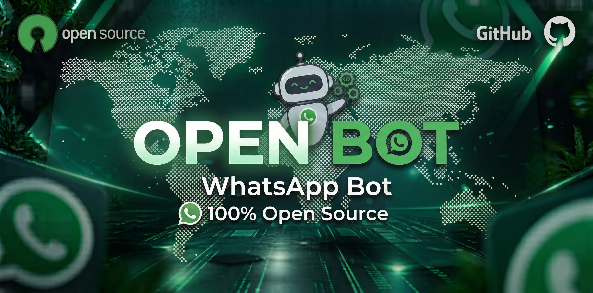

<p align="center"></p>

<h1 align="center">Open Bot</h1>
<p align="center">WhatsApp Bot · 100% Open Source · PT / EN / ID</p>

<p align="center">
  
  <a href="https://github.com/Blackhzx/OpenBot/stargazers"></a>
  <a href="https://github.com/Blackhzx/OpenBot/fork"></a>
  
</p>

---

## Tutorial em vídeo

[](https://youtu.be/cIY0vtFt1LM)

Assista o passo a passo da instalação: https://youtu.be/cIY0vtFt1LM

## Instalação

Precisa do **Node 22.13+**.

```bash
git clone https://github.com/Blackhzx/OpenBot
cd OpenBot
npm start
```

Na primeira vez o `npm start` pergunta onde o bot vai rodar e instala tudo sozinho:

| opção | o que faz |
|---|---|
| `1) Termux` | `pkg install ffmpeg git` (se faltar) e `npm install --no-bin-links` |
| `2) VPS / hospedagem` | `npm install` e avisa se faltar o ffmpeg |

O Termux já vem sugerido quando detectado (é só dar Enter). Se as dependências já estiverem instaladas, ele pula essa parte.

> `npm start` usa código de pareamento. Para QR code: `npm run qr`

### Primeira vez

Na primeira vez que liga, o bot pergunta no terminal:

1. nome do dono
2. número do dono (aceita `+55 (11) 99999-9999`, `11999999999` e outros formatos)
3. apikey da Zone (opcional, Enter pula)
4. número para parear com o bot

Fica tudo salvo no `config.json`. Para refazer: `npm run setup`.

Funciona no Termux, VPS e Pterodactyl (digite as respostas no console do painel). Se o host não tiver terminal, edite o `config.json` à mão e coloque `"configurado": true`.

Números sem `+` e com 10 ou 11 dígitos são tratados como brasileiros (o `55` é adicionado). Para outros países, digite com `+` (ex: `+1 415 555 2671`).

### Termux

O `npm start` já ativa o `termux-wake-lock`, que impede o Android de pausar o bot. Desative também a otimização de bateria do Termux (Configurações > Apps > Termux > Bateria > Sem restrições), senão a conexão cai com código 408 quando a tela apaga.

## Sessão (SQLite)

A conexão fica salva em um único arquivo, `database/sessao.db` (SQLite com WAL), em vez de centenas de arquivos JSON. Abre mais rápido, grava as chaves em transação e não corrompe em queda de energia.

Para desconectar e parear de novo, apague `database/sessao.db*`.

## Config (`config.json`)

| campo | descrição |
|---|---|
| `nome` | nome do bot |
| `nomeDono` | nome do dono (aparece nas figurinhas) |
| `prefixo` | prefixo dos comandos |
| `dono` | números do dono (só dígitos) |
| `idioma` | `pt`, `en` ou `id` |
| `botoes` | menu com botão (native flow) on/off |
| `pairCode` | código de pareamento personalizado (8 caracteres) ou vazio |
| `foto` | foto do menu |
| `zone.url` / `zone.apikey` | URL e chave da System Zone API |
| `configurado` | `false` faz o bot perguntar a configuração de novo |

## Comandos

| geral | admin | dono |
|---|---|---|
| menu | ban | idioma |
| s / f | promover | botoes |
| toimg / togif / tovideo | rebaixar | prefixo |
| removebg / rbg | | |
| sfundo | | |
| rename pack / autor | | |
| gpt / ia / chatgpt | | |
| play / playvideo | | |
| pinterest / pin | | |
| tiktok / ttk / tt | | |
| instagram / insta / ig | | |
| facebook / face / fb | | |
| kwai | | |
| twitter / tw / x | | |
| ping | marcar | setmenu |
| dono | grupo abrir/fechar | setfoto |
| ola | autofigu | |

## Figurinhas

| comando | resultado |
|---|---|
| `!s` / `!sticker` / `!figurinha` | o WhatsApp estica a figurinha para 512x512 |
| `!f` / `!figu` | a figurinha fica no tamanho original |
| `!toimg` | figurinha vira imagem, ou GIF se for animada |
| `!togif` / `!tovideo` | figurinha animada vira GIF / vídeo |
| `!sfundo` | tira o fundo de uma figurinha estática (API) |
| `!autofigu` (admin) | toda imagem ou vídeo de até 20s vira figurinha |

O arquivo da figurinha nunca é deformado: o `!s` só avisa o WhatsApp para mostrar em 512x512. Por isso o `!toimg` devolve a imagem no formato original.

Responder uma figurinha com `!s` ou `!f` troca a descrição dela (roubar).

## Renomear figurinha

`!rename pack / autor` (ou `!take`) respondendo uma figurinha troca a descrição dela.

## YouTube

| comando | resultado |
|---|---|
| `!play nome ou link` | capa com título, canal, duração e tamanho, depois o áudio |
| `!playvideo nome ou link` (`!playvid`) | vídeo em 360p com título, duração e tamanho |

Precisa da `apikey` da Zone no `config.json`.

## ChatGPT

`!gpt pergunta` (ou `!ia` / `!chatgpt`). Cada pessoa tem a própria conversa em cada grupo, então ele lembra do que foi dito antes.

Para analisar uma imagem ou figurinha, mande a imagem com `!gpt pergunta` na legenda ou responda uma imagem ou figurinha com `!gpt` (figurinha animada: ele lê o primeiro quadro). A imagem sobe temporariamente no `cdn.zone.api.br` (apaga sozinha em 10 minutos).

## TikTok

`!tiktok link` (ou `!ttk` / `!tt`) baixa o vídeo com título, autor, curtidas, comentários, compartilhamentos e música na legenda. Post de fotos vem em álbum. Precisa da `apikey` da Zone.

## Redes sociais

| comando | rede |
|---|---|
| `!instagram link` (`!insta` / `!ig`) | Instagram |
| `!facebook link` (`!face` / `!fb`) | Facebook |
| `!kwai link` | Kwai |
| `!twitter link` (`!tw` / `!x`) | Twitter / X |

A mídia vem com autor, duração, curtidas, visualizações, comentários, compartilhamentos e legenda (o que a API mandar), e um botão para abrir o post. Carrossel: o resto vem em álbum. Precisa da `apikey` da Zone.

## Pinterest

`!pinterest termo | quantidade | tipo` (ou `!pin`) manda as mídias em álbum.

```
!pin paisagem                 6 resultados (padrão)
!pin paisagem | 10            10 resultados (máximo 50)
!pin paisagem | 4 | imagem    só imagens
!pin paisagem | 4 | video     só vídeos
```

## System Zone API (`lib/zone.js`)

Coloque a chave no `config.json`:

```json
"zone": { "url": "https://zone.api.br", "cdn": "https://cdn.zone.api.br", "apikey": "SUA_KEY" }
```

Uso dentro dos cases e plugins:

```js
const zone = require('./lib/zone')
await zone.toMp4(buffer)                  // pronto
await zone.get('api/rota', { q: 'oi' })   // qualquer rota GET
await zone.post('api/rota', buffer)       // qualquer rota com arquivo
await zone.sse('api/rota', { q: 'oi' })   // rota em stream (data: {...})
await zone.cdn(buffer, 10)                // upload temporário, devolve o link
await zone.gpt('oi', 'sessao', urlImagem) // chatgpt
```

O `!toimg` de figurinha animada, o `!removebg` e o `!sfundo` usam a API. Figurinha normal converte local, sem API.

## Menus (`menu.json`)

Cada menu é separado e usa os mesmos enfeites:

| comando | menu |
|---|---|
| `!menu` | menu principal |
| `!menuadm` / `!menuadmin` / `!menu adm` | menu de admin |
| `!menudono` / `!menuowner` / `!menu dono` | menu do dono |

```json
{
  "topo": "┌──「 *{bot}* 」\n│ {usuario}: {nome}\n│ {prefixoTxt}: {p}\n└────────────",
  "secao": "┌──「 *{titulo}* 」",
  "item": "│ › {p}{cmd}",
  "fim": "└────────────",
  "rodape": "_{bot} · open source_",
  "menu": ["menuadm", "menudono", "ping", "dono", "ola"],
  "menuadm": ["ban", "promover", "rebaixar", "marcar", "grupo abrir/fechar"],
  "menudono": ["idioma pt/en/id", "botoes on/off", "prefixo", "setmenu", "setfoto"]
}
```

Com `!botoes on`, o `!menu` mostra a foto e um botão só com os nomes dos menus (Comandos, Menu Admin, Menu Dono e os que você criar). Escolhendo um, o bot manda aquele menu em texto normal.

Qualquer lista nova no `menu.json` vira um menu com o próprio nome (ex: `"menujogos": [...]` cria o `!menujogos`).

Variáveis: `{bot}` `{nome}` `{p}` `{grupo}` `{idioma}` `{titulo}` `{cmd}`, e qualquer chave do `lang/` (ex: `{usuario}`).

Também dá para editar pelo WhatsApp (dono):

```
!setmenu                         mostra a ajuda
!setmenu item │ ✦ {p}{cmd}       muda o enfeite dos itens
!setmenu topo ╔══ {bot} ══╗      muda o cabeçalho
!setmenu menujogos dado, quiz    cria/edita um menu
!setmenu menujogos               apaga o menu
!setfoto                         responda uma imagem para trocar a foto do menu
```

As edições valem na hora, sem reiniciar.

## Plugins

Crie um arquivo em `plugins/` e adicione o comando no `menu.json`:

```js
module.exports = {
  cmd: ['oi', 'hi'],
  tag: 'admin', // permissão: admin | dono (opcional)
  run: async ({ god, m, from, reply, args, q, isAdm, isDono }) => {
    reply('oi!')
  }
}
```

Botões em plugins (native flow `single_select`):

```js
run: ({ lista, p }) => lista({
  texto: 'Escolha:',
  foto: fs.readFileSync('./media/openBot.jpg'), // opcional
  secoes: [{ title: 'Opções', rows: [{ title: 'Ping', id: p + 'ping' }] }]
})
```

O cliente pode ser chamado como `god`, `conn`, `sock`, `Socket` ou `systemZR`.

## Idiomas

Adicione um `.json` em `lang/` e ele já aparece no `!idioma`.

---

Feito com [@systemzero/baileys](https://www.npmjs.com/package/@systemzero/baileys) · Licença MIT
